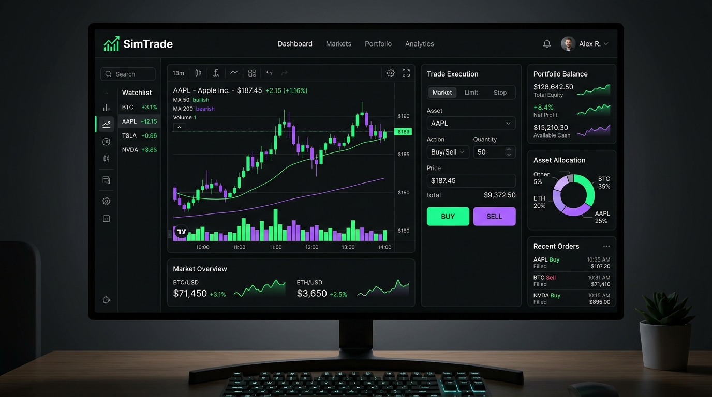
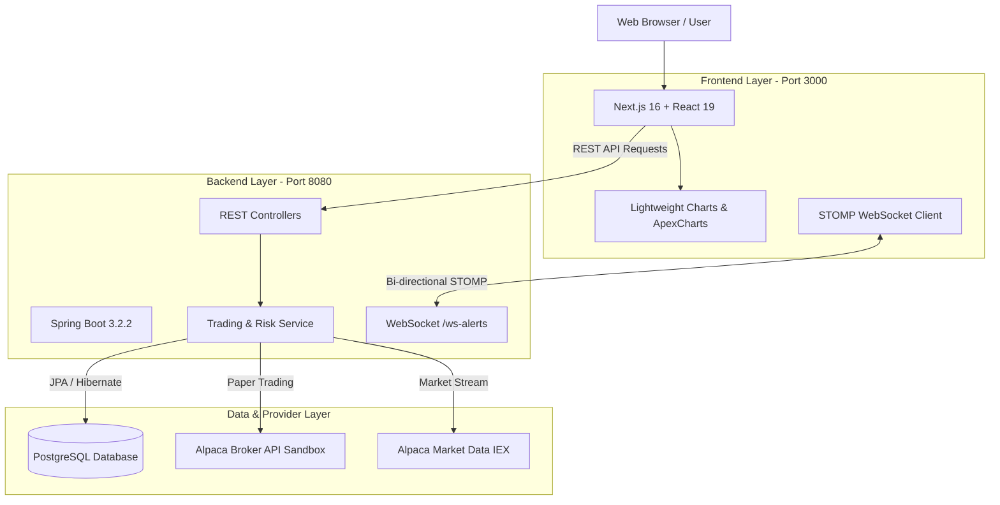

<div align="center">

# SimTrade

**Full-Stack Simulated Stock & Cryptocurrency Trading Platform**  
*ระบบจำลองการซื้อขายหุ้นและคริปโทเคอร์เรนซีเสมือนจริง พร้อมระบบวิเคราะห์พอร์ตและบริหารความเสี่ยง*

<br/>

[](https://nextjs.org/)
[](https://react.dev/)
[](https://www.typescriptlang.org/)
[](https://tailwindcss.com/)
[](https://spring.io/projects/spring-boot)
[](https://www.oracle.com/java/)
[](https://www.postgresql.org/)
[](https://alpaca.markets/)
[](backend/LICENSE.txt)

<br/>

<p align="center">
  
</p>

</div>

---

## Table of Contents

- [Overview](#overview)
- [Key Features](#key-features)
- [System Architecture](#system-architecture)
- [Tech Stack](#tech-stack)
- [Project Structure](#project-structure)
- [Prerequisites](#prerequisites)
- [Quick Start](#quick-start)
  - [1. Clone Repository](#1-clone-repository)
  - [2. Database Setup](#2-database-setup)
  - [3. Backend Setup](#3-backend-setup)
  - [4. Frontend Setup](#4-frontend-setup)
- [Environment Configuration](#environment-configuration)
- [Troubleshooting](#troubleshooting)
- [License](#license)

---

## Overview

**SimTrade** คือแพลตฟอร์มจำลองการเทรดหุ้นและคริปโทเคอร์เรนซี (Paper Trading Platform) พัฒนาแบบ Full-Stack เพื่อจำลองสภาวะตลาดจริงโดยไม่ต้องใช้เงินจริง เชื่อมโยงข้อมูลตลาดแบบเรียลไทม์ผ่าน **Alpaca API** เหมาะสำหรับการศึกษา วิเคราะห์พอร์ตโฟลิโอ และทดสอบกลยุทธ์การบริหารความเสี่ยง (Risk Management)

---

## Key Features

| Category | Capability | Description |
| :--- | :--- | :--- |
| **Market Data** | Live Feeds & Charts | แสดงข้อมูลราคาหุ้นและเหรียญแบบเรียลไทม์ด้วย TradingView Lightweight Charts และ ApexCharts |
| **Trading Engine** | Order Execution | รองรับทั้งหุ้น (US Equities, S&P 500) และสินทรัพย์คริปโต (BTC, ETH) ทั้ง Market และ Limit Order |
| **Portfolio** | Tracking & Analytics | ติดตาม Equity, Cash Balance, P&L (Unrealized / Realized) และประวัติการทำรายการย้อนหลัง |
| **Risk & Feedback**| Trader Rules Engine | ระบบกำหนดโปรไฟล์เทรดเดอร์ (Trader Types) พร้อมตั้งค่าขีดจำกัดความเสี่ยง (Risk Configs) |
| **Real-time Engine**| WebSockets & Alerts | แจ้งเตือนสถานะคำสั่งซื้อขายและสถานะพอร์ตทันทีผ่าน STOMP Protocol |
| **Administration** | Admin Control Panel | จัดการตั้งค่าพารามิเตอร์ด้านความเสี่ยงและการให้ผลตอบรับของระบบ |

---

## System Architecture



---

## Tech Stack

### Frontend
- **Framework**: Next.js 16 (App Router)
- **Library**: React 19, TypeScript
- **Styling**: Tailwind CSS 4
- **Visualization**: TradingView Lightweight Charts, ApexCharts
- **Real-Time**: `@stomp/stompjs`
- **Icons & UI**: Lucide React, Heroicons, React Hot Toast, Next Themes

### Backend
- **Framework**: Spring Boot 3.2.2
- **Language**: Java 17+
- **Build Tool**: Gradle
- **Persistence**: Spring Data JPA, Hibernate ORM
- **Cache**: Spring Cache, Caffeine Cache
- **Broker SDK**: Alpaca Java SDK (`alpaca-java`)
- **Database**: PostgreSQL 15+

---

## Project Structure

```text
SimTrade/
├── docs/                      # เอกสารประกอบและรูปภาพตัวอย่าง
│   └── preview.jpg
├── backend/                   # Backend Service (Spring Boot)
│   ├── src/main/java/com/alpaca/web/
│   │   ├── Application.java   # Main entry point & API beans
│   │   ├── controller/        # REST endpoints
│   │   ├── Service/           # Core trading & business logic
│   │   ├── Repository/        # Database access layer
│   │   ├── entity/            # JPA database models
│   │   ├── dto/               # Data transfer models
│   │   └── corsconfig/        # CORS security configuration
│   ├── build.gradle           # Build dependencies
│   ├── gradlew / gradlew.bat  # Gradle wrapper scripts
│   └── .env.example           # ตัวอย่าง Environment variables
│
├── frontend/                  # Frontend Client (Next.js)
│   ├── src/app/
│   │   ├── dashboard/         # Portfolio summary & metrics
│   │   ├── trade/             # Stocks trading interface
│   │   ├── tradecrypto/       # Crypto trading interface
│   │   ├── analytics/         # Performance analytics
│   │   ├── History/           # Transaction history
│   │   ├── admin/             # Risk & config dashboard
│   │   └── login / register/  # Authentication views
│   ├── package.json           # Frontend dependencies
│   └── tsconfig.json          # TypeScript configuration
│
├── .gitignore                 # Root Git ignore rules
└── README.md                  # Project documentation
```

---

## Prerequisites

ตรวจสอบให้แน่ใจว่าเครื่องของคุณมีเครื่องมือดังต่อไปนี้:

- **Node.js**: `v18.18+` หรือ `v20.x`
- **Java JDK**: `17` หรือ `21`
- **PostgreSQL**: `14+`
- **Alpaca Markets Account**: บัญชี [Alpaca](https://alpaca.markets/) (สำหรับรับ API Key ฟรีในโหมด Paper Trading & Broker Sandbox)

---

## Quick Start

### 1. Clone Repository

```bash
git clone https://github.com/puppypud/SimTrade.git
cd SimTrade
```

### 2. Database Setup

สร้างฐานข้อมูลใน PostgreSQL:

```sql
CREATE DATABASE simtrade;
```

### 3. Backend Setup

1. ไปยังโฟลเดอร์ `backend`:
   ```bash
   cd backend
   ```

2. สร้างไฟล์ `.env` จากเทมเพลต:
   - **Windows (PowerShell)**:
     ```powershell
     Copy-Item .env.example .env
     ```
   - **macOS / Linux**:
     ```bash
     cp .env.example .env
     ```

3. ระบุค่าการเชื่อมต่อในไฟล์ `backend/.env`:
   ```env
   DB_URL=jdbc:postgresql://localhost:5432/simtrade
   DB_USERNAME=postgres
   DB_PASSWORD=your_password

   BROKER_API_KEY=your_alpaca_broker_key
   BROKER_API_SECRET=your_alpaca_broker_secret
   TRADING_API_KEY=your_alpaca_trading_key
   TRADING_API_SECRET=your_alpaca_trading_secret
   ```

4. รัน Backend Service:
   - **Windows**:
     ```cmd
     gradlew.bat bootRun
     ```
   - **macOS / Linux**:
     ```bash
     chmod +x gradlew
     ./gradlew bootRun
     ```

> [!NOTE]
> เมื่อรันสำเร็จ Backend Service จะพร้อมทำงานที่ `http://localhost:8080`

### 4. Frontend Setup

1. เปิด Terminal ใหม่แล้วไปยังโฟลเดอร์ `frontend`:
   ```bash
   cd frontend
   ```

2. ติดตั้ง Dependencies และเริ่ม Development Server:
   ```bash
   npm install
   npm run dev
   ```

3. เข้าใช้งานผ่าน Web Browser:
   ```
   http://localhost:3000
   ```

---

## Environment Configuration

ตารางตัวแปรที่จำเป็นสำหรับ `backend/.env`:

| Key | Description | Example |
| :--- | :--- | :--- |
| `DB_URL` | JDBC Connection String | `jdbc:postgresql://localhost:5432/simtrade` |
| `DB_USERNAME` | PostgreSQL User | `postgres` |
| `DB_PASSWORD` | PostgreSQL Password | `secret` |
| `BROKER_API_KEY` | Alpaca Broker Sandbox Key | `CK...` |
| `BROKER_API_SECRET` | Alpaca Broker Sandbox Secret | `...` |
| `TRADING_API_KEY` | Alpaca Paper Trading Key | `PK...` |
| `TRADING_API_SECRET`| Alpaca Paper Trading Secret | `...` |

---

## Troubleshooting

<details>
<summary>Database connection refused (Port 5432)</summary>

- ตรวจสอบว่า PostgreSQL Service กำลังรันอยู่
- ตรวจสอบชื่อฐานข้อมูล, พอร์ต และรหัสผ่านในไฟล์ `backend/.env` ว่าถูกต้อง
</details>

<details>
<summary>Alpaca API 401 Unauthorized</summary>

- ตรวจสอบว่า Key ที่ใช้เป็นของ Paper Trading / Sandbox
- ตรวจสอบว่าไม่มีช่องว่าง (whitespace) นำหน้าหรือต่อท้ายคีย์ใน `.env`
</details>

<details>
<summary>Java version mismatch</summary>

- Spring Boot 3.2 ต้องใช้ Java JDK 17 ขึ้นไป
- ตรวจสอบด้วยคำสั่ง:
  ```bash
  java -version
  ```
</details>

---

## License

Distributed under the MIT License. See [LICENSE.txt](backend/LICENSE.txt) for more information.

---

<div align="center">
<sub>Built with Next.js, Spring Boot, and Alpaca Markets API.</sub>
</div>
